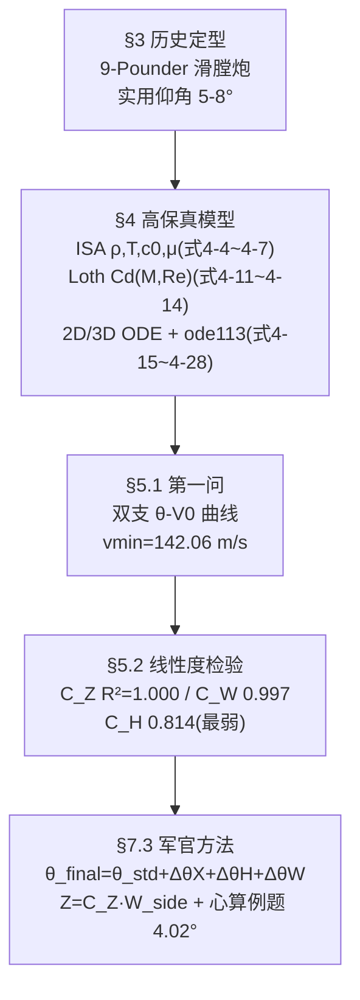

# 2025-GM-B-188（2025 题B · 队伍 188 · 69 页）

## 来自赏析

### 论文速览

这是本批次篇幅最长的一篇（正文 26 页 + 附录 43 页），走"高保真物理模型 + 查表修正系数"的双层路线：建模侧集成国际标准大气 ISA（温度/密度/声速/黏度随高度变化，式 4-4 至 4-7）、基于 Mach 数与 Reynolds 数的球形弹动态阻力系数（采用 Loth 等 2021 年 AIAA Journal 的分段复合公式，式 4-11 至 4-14）以及二维/三维弹道 ODE 组（式 4-22、4-26），用 MATLAB ode113（Adams–Bashforth–Moulton）积分；应用侧把复杂物理预先折叠成四个修正系数（射程 $C_X$、高度 $C_H$、纵风 $C_W$、侧风 $C_Z$）与一张射表，军官只需"查标准角 + 三次乘加"即可完成修正。数值结论：$V_0=400$ m/s 打 1200 m/500 m 目标需低角 $\theta=3.5453°$；阻力使最小初速从真空的 108.44 m/s 升至 142.06 m/s；场地心算示例完整演示 1300 m/800 m/逆风 5 m/s/侧风 10 m/s 工况得 $\theta_{final}=4.02°$、横移 13.1 m。

### 获奖密码

1. **阻力建模的代差优势**：Mach–Reynolds 双参数动态 $C_D$ + ISA 大气，把 450 m/s 超音速球弹的真实气动（跨音速阻力激增）纳入模型，物理深度超出"常数 $C_D$"队一档；
2. **历史考证驱动建模**：由 11 cm≈4.2/4.62 英寸推断 9/12-pounder 滑膛炮、直瞄射击战术对应 0–8° 俯仰范围（3.1 节），从武器史角度约束解空间，扣题极紧；
3. **"线性度检验先行"的可计算性设计**：先证明 $C_Z$/$C_W$/$C_H$ 在作战包线内近似线性（$R^2$ 全部报告），再把物理折叠成查表系数——修正方法的使用前提被显式验证，而非默认成立；
4. **完整心算示例**（7.3.3）：从查表到三次乘加到横移量，一步一步演算给评委看，"无计算器可用"被落实为可执行程序；
5. **多层自洽性检验**：真空对照、末速分析、$C_D$–$M$ 文献比对、线性度 $R^2$，形成验证矩阵；
6. **坦诚且具体的弱点**（射表精度不适于手查），显示对方法可用边界的清醒认知。

### 可借鉴清单

1. 涉及高速弹丸/强气动问题时，用 $C_D(M,Re)$ 动态系数替代常数阻力，并给出 $C_D$–$M$ 曲线与文献出处（Loth 2021 AIAA 即可复用）；
2. 大气性质用 ISA 分层公式（4-4 至 4-7 一套即可），比"密度指数衰减"更专业且实现成本相同；
3. 任何"简化为线性"的经验修正，都必须先做线性度检验并报告 $R^2$，同时解释非线性的物理来源（如高度项 $R^2=0.814$ 归因于密度的指数变化）；
4. 手工估算方法要配一个全流程心算示例（标准角→距离修正→高度修正→风修正→横移），步骤编号化；
5. 真空模型留作基线对照（$V_{min}$ 差值 33.6 m/s）是最廉价有力的模型自检；
6. 射表设计要面向用户：为人工查表保留 2–3 位有效数字与内插指引，而不是把求解器原始精度整表粘贴（本文自评的教训）。

## 来自精读

### 全文骨架



**为什么这个骨架好？** 它把"无计算器"问题的本质说破了：**不是不用模型，而是把模型的一切非线性都冻结成查表值与常数斜率**。§5.2 的三个 R² 就是"冻结是否合法"的检验——这一步使交付物从"经验凑合"升级为"经过验证的一阶展开"，是全文最亮的方法论。69 页的体量里正文仅 26 页，附录占 43 页（代码+三张全射表），"正文薄、附录厚"的配比值得抄。

---

### 建模决策链

| 决策 | 作者的选择 | 被放弃的替代 | 为什么 |
|---|---|---|---|
| 历史定型 | M1857 滑膛野战炮、低伸弹道优先 | 泛化"19世纪火炮" | 让 5–8° 仰角、1.5 km 射程成为先验 |
| 大气 | 全套 ISA+黏度 | 指数大气（204/428） | Re 需要逐点 μ；物理自洽 |
| 阻力 | Loth Cd(M,Re)（声称） | 常数/分段 Cd | 出膛 M=1.33 跨声速峰 |
| 求解器 | ode113 + 事件函数 + fzero/fminbnd | RK4 手写（155/207） | 变阶多步法+严格容差 |
| 交付 | 四系数表 + 心算程序 + 例题 | 完整射表卡片（207/428） | 89 行射表在附录，正文只给系数 |
| 验证 | **线性度 R² 检验**（全场唯一） | 盲测（155）、误差图（207） | 检验"线性化"这个方法本身 |

**独立复现审计汇总**（Python+scipy，复算 Loth 模型与其对照）：
- **⚠ 重大疑点：论文交付数值与 Loth 模型不符，与常数 Cd≈0.5 模型吻合。** 复算 Loth：θ_std,low = 6.83/5.48/4.56/3.86°（V₀=300/350/400/450）；论文：6.15/4.59/3.55/2.79°；而常数 Cd=0.5 复算给 6.21/4.54/3.47/2.74°，与论文几乎逐点吻合。射表交叉验证：论文 Table 2 (400 m/s, 3°)→1076 m，Loth 复算 925 m，常数 0.47 复算 1113 m——同样倒向常数模型。
- vmin：Loth 复算 ≈143 m/s，论文 142.06 m/s ✓（低马赫区 Loth≈常数 Cd，无法区分，此项相容）。
- 修正系数心算例题内部算术自洽 ✓（0.46−0.05+0.06=0.47，θ_final=4.02 ✓），但 ⚠ C_H 正文斜率（−0.0094）与附录（−0.0169）差 80%；C_W 两处差 4%。
- ⚠ §4.1 说真空 vmin=108.50，§5.1 又引 108.44，前者正确。
- 另一处工艺问题：式 (7-1) 把阻力写成 "C_d=½C_dρV²A"（左端应为 F_D），符号笔误。
- 值得肯定：附录代码含 AI 辅助声明脚注（"Generative AI Assisted Coding on program framework...Algorithms...are not included"），这是合规披露的范本。

**总评**：物理叙事（ISA+Loth+线性度检验）是十三篇里最完整的，但**"所述模型"与"所出数据"脱节**——大概率是最终数值由某版常数 Cd 代码生成后未随模型升级同步。教训：模型升级后必须重跑全部交付表，并保留一张"模型版本-数据版本"对照。

---

### 可复用模板

**结构模板**：
```
1-2 引言/记号      历史背景 + 符号表(含"具体数值后文给出")
3 Assumptions      历史定型(炮型/仰角先验) + 三阶段 firing process + 重力
4 Modelling        4.1 真空基线 → 4.2 大气 → 4.3 动态Cd → 4.4 2D → 4.5 3D
                   → 4.6 风场假设(均匀/无垂直风/方位角)
5 Verification     5.1 第一问(双支曲线+极限速度)  5.2 线性度检验(R²×3)
6 S&W              按模型分 Model 1 / Model 2 各自评
7 Discussion       外形影响 + Navier-Stokes 为何解不动 + 军官方法(表+程序+心算例)
8 Conclusion       方法论一句话 + R² 复述
Appendix           系数表 + 89行射表 + θ查找表 + 23页代码(含AI声明)
```

**句式库（原文英文句）**：
- "The core methodology integrates a high-precision physical model with simplified correction coefficients for manual estimation..."（架构式摘要）
- "The development of a practical field estimation method ... relies fundamentally on the assumption that correction factors ... can be treated as linear constants within the operational envelope. To validate this assumption, a linearity check was performed..."（线性度检验的标准开场）
- "While the R² value is the lowest of the three tests, a value above 0.8 is generally considered an acceptable fit for engineering approximations over a limited operational range."（弱拟合的分级辩护）
- "This procedure transforms complex ballistic computations into simple multiplication and addition, suitable for rapid, non-digital field estimation."（交付物定位句）
- "However, we wouldn't reject other possible trajectories, for there might be cases where direct firing is impossible..."（先验筛选留后门）

**图表配方**：动态系数模型 → "Cd–Ma 曲线必画（跨声速峰=叙事核心）"；线性化方法 → "每个修正系数一张散点+拟合线+R² 标注"；双支解 → "θ–V₀ 曲线两支合并于 vmin，交点即物理"。

---
*对照阅读：`05_论文赏析/2025/2025-GM-B-188.md`、`07_题目解读/2025_题B_火炮弹道射表.md`；Loth 模型的正确打开方式看 207（精读 64，其 Table 1 与本文复算吻合到 0.005°）；同样讲 5–8° 历史仰角的还有 460（精读 67）。*
