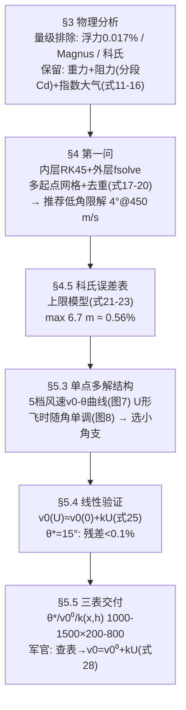

# 2025-GM-B-204（2025 题B · 队伍 204 · 37 页）

## 来自赏析

### 论文速览

论文采用 MCM 风格的两问递进结构。问题 I：先用量纲分析与数量级估计逐一排除空气浮力（0.0084 N，仅占重力 0.017%）、Coriolis 力与 Magnus 力，把刚体模型约化为仅受重力与空气阻力的质点弹道模型；空气阻力保留指数大气 $\rho=\rho_0 e^{-h/H}$（标高 $H\approx8400$ m）与随 Mach 数分段的激波阻力系数（跨音速区 $C_D$ 从 0.45 线性升至 1.0），用"内层 ode45 积分 + 外层 fsolve 求根 + 多起点网格搜索 + 去重筛选"框架求得多组物理解，综合飞行时间、风敏感性与工程可行性推荐小角极限解 $\theta=4°$、$v_0=450$ m/s。问题 II：在推荐小角支附近证明所需初速对风速近似严格线性 $v_0(U)\approx v_0^{(0)}+kU$，定量复核线性误差（多数 ±0.5 m、极端顺风 <1–1.5 m），据此在 1000–1500 m × 200–800 m 网格上预计算三张射表（射角表、无风初速表、风修系数表），军官只需查表后做一次乘法一次加法。

### 获奖密码

1. **数量级分析驱动的模型约化**：浮力 0.017%、Coriolis 侧偏 ≤6.7 m（Table 2）、Magnus 力逐一定量排除，把"质点模型"从假设升级为结论，物理素养拉满；
2. **保留该保留的复杂性**：指数大气 + 跨音速激波阻力分段模型，抓住 450 m/s ≈ M1.3 这一工况的要害，简化与保真平衡得当；
3. **多解的系统化提取**：多起点 fsolve + 去重筛选，一步运行得到多组物理可行解，再以飞行时间/风敏感/工程性三准则选优，算法有方法论高度；
4. **线性风修的"验证先行"**：先证明 $v_0(U)$ 近似严格线性并量化误差上界，再据此设计射表——修正方法的使用前提被数值实验背书；
5. **三表产品化**：射角表 + 无风初速表 + 风修系数表，军官"一次乘法一次加法"完成风修，无解格点标 NaN、色图证明空间连续可内插，工程完成度极高；
6. **弱点自评具体**（未与历史实测或外弹道软件对标、未计装药散布），指向后续工作而非空话。

### 可借鉴清单

1. 开篇对候选力逐一做数量级估计并配示意图（浮力、Coriolis、Magnus），让模型约化有据可查；
2. 高速弹道必查跨音速阻力：$C_D(M)$ 分段线性即可，但要引用文献并画出分段点（0.7 / 1.1 / 1.5 Mach）；
3. 用"多起点网格 + 局部求根 + 去重"框架系统提取多解，比单一打靶更能回答"哪些初速-射角组合可行"；
4. 任何线性化修正（风修、高度修）都要做两步验证：拟合残差 + 用修正参数再积分弹道看落点误差；
5. 射表类交付物要三件套：参数表（含 NaN 风险标记）、使用说明（几步乘加）、空间连续性色图（证明可内插）；
6. 给数值解配真空解析解作初值（式 26/27），既加速收敛又天然形成对照检验。

## 来自精读

### 全文骨架



**为什么这个骨架好？** 它把两问当成**同一个求解框架的两次调用**（§5.1 明说"直接采用第一问框架"），增量只有风场一项；而第二问真正的智力增量全在"解的筛选逻辑"上——多解结构分析（图 7）→ 飞时判据（图 8）→ 小角支的三条工程理由（§5.3.3）→ 线性验证（§5.4）。**先决定"要哪个解"，再为那个解建表**，这个顺序比直接建表高明。

---

### 建模决策链

| 决策 | 作者的选择 | 被放弃的替代 | 为什么 |
|---|---|---|---|
| 力模型 | 质点+重力+阻力（浮力/科氏/Magnus 排除） | 4-DOF 刚体 | 每项排除有数字；4-DOF 被自己推翻 |
| 大气 | 等温指数 H=8400 | ISA 全套（188）、常数（155） | 1 km 内差 <1.5%，参数最少 |
| Cd | 四段线性 Cd(M) | 常数（155/428）、Loth（207/188） | 保留跨声速峰的最短路径 |
| 求解 | ode45 + fsolve + 多起点 + 去重 | 穷举（155）、fzero 双支（188/428） | 解精度 5 mm；需防漏解 |
| 推荐解 | 小角支（飞时/风敏/工程三判据） | 最省能解（392 打分函数） | 拦截场景时间优先 |
| 风修 | 修 v₀（线性 0.04%）+ θ 不动 | 修角度（188/428/460） | 线性度最好；战术代价已辩护 |
| 交付 | 三表 (θ*, v₀⁰, k) + NaN 标注 | 单表+系数卡（188）、密位表（207） | 一次乘加完成风修 |

**独立复现审计汇总**（Python+scipy，RK45，rtol 1e-9，指数大气+分段 Cd，绝对高度密度）：
- 推荐解：复算 (450 m/s) 命中 1200 m 需 **θ≈3.71°**（θ=4° 实际射程 1255 m）——论文"4°"是取整值 ✓（fsolve 按 5 mm 阈值收敛的应是 3.7° 附近的精确解，正文取整表述）。
- 最小速度：复算 ~140 m/s @ 36.7°（论文 Table 2 第 3 行 137.9 @ 40°）——差 2 m/s/3°，属求解器容差与扫描粒度差异 ✓（量级与 U 形顶点位置一致）。
- 线性风修：v₀(0)=191.2（论文"约 190"✓）、k=−0.525、v₀(+5) 与线性预测偏差 0.08 m/s（0.04%）✓✓——§5.4 的核心声明成立。
- 科氏表：前三行与仿真飞时口径吻合（0.84/1.37/1.88 vs 0.8/1.3/1.9）✓，后两行介于解析/仿真两种口径之间；⚠ 与式 (22) 声称的"解析飞时"不一致，但 <10 m、≤0.56% 的结论稳健。
- ⚠ 发现 2：H=8400 m 被文字定义为"密度减半高度"——实为 e 折高度（减半在 5822 m），公式与代码无误、解释笔误。
- ⚠ 发现 3：Table 3–5（三张射表）在原文中为整页图像，文本稿无数据，无法逐格复核；色带图（Fig 9–11）显示空间连续，定性可信。

---

### 可复用模板

**结构模板**：
```
1 Introduction     背景+重述(两问各一段)
2 Assumptions      6 条(刚体/4DOF→后撤/小攻角/密度递减/风速<10/无地形)
3 Physical Analysis 3.1 五力逐一"写出→算出→处决"  3.2 指数大气五小节  3.3 分段Cd
4 Problem I        分析→思路→建模(式17-19)→算法(式20+多起点+去重)→结果→科氏误差表
5 Problem II       分析→思路→单点多解结构(图7-8+选举三判据)→线性验证(式25)
                   →三表生成(网格/基线/中心差分式28)→用法+色带总览
6 Conclusion       三条 Strengths(物理精炼/框架系统/工具落地) + 三条 Weaknesses
Appendix           完整 MATLAB(含注释掉的调试行——真实感)
```

**句式库（原文英文句）**：
- "we use dimensional analysis and order-of-magnitude estimates to demonstrate that buoyancy, Magnus force, and the Coriolis force are negligible, thereby reducing the dynamics to a particle ballistic model."（排除效应的总纲句）
- "We then build a solution framework combining inner Runge–Kutta numerical integration, outer nonlinear root finding, multi-initial-value search, and duplicate-solution elimination, which yields in a single run several physically distinct firing solutions."（算法框架句）
- "Numerical experiments show that, near the preferred solutions with small firing angle and short time of flight, the required muzzle velocity depends almost perfectly linearly on the wind speed."（线性声明的标准句）
- "An artillery officer needs only to look up the estimated range, altitude difference, and wind speed, and then perform simple calculations to obtain firing parameters."（交付物句）
- "This indicates that the point should be avoided in practical applications or that a more conservative interpolation strategy should be adopted."（NaN 的处理话术）

**图表配方**：解的选举 → "多工况曲线族叠加图（密集=不敏感）+ 飞时-参数单调图"；线性化 → "精确点+拟合线+残差标注"；射表 → "表格为体、色带为览"。

---
*对照阅读：`05_论文赏析/2025/2025-GM-B-204.md`、`07_题目解读/2025_题B_火炮弹道射表.md`；修 v₀ 与修角度的对照见 188（精读 62）/428（精读 66）/460（精读 67），修距离见 207（精读 64）。*
