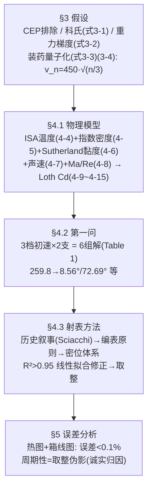

# 2025-GM-B-207（2025 题B · 队伍 207 · 38 页）

## 来自赏析

### 论文速览

论文为 19 世纪中叶球形弹丸火炮建立了一套"机理弹道模型 + 炮兵射表"双层体系：底层采用 Loth 等人（AIAA Journal 2021）提出的覆盖亚—超—高超声速的球形阻力系数模型做数值弹道；顶层把解算结果压缩成 3 种装药 × 平射/曲射 × 射程 1000–1500 m（步长 50 m）的射表，附纵风、横风、高程差、海拔四类整数修正量。问题一给出 1200 m 目标在 3 档装药下的 6 组解（如 $v_3=450$ m/s 时 $\theta_1=3.8231°$、$\theta_2=77.1028°$），误差分析显示射表落点误差平均 1.20 m、最大 3.53 m（约 0.1%）。

### 获奖密码

1. **阻力模型选型高级且有出处**：Loth 2021 球形阻力模型覆盖跨/超声速，恰好对应 450 m/s（约 Ma 1.3）弹道先超后亚的真实过程，比常用固定 $C_D$ 或牛顿阻力高一个档次，并在 Discussion 中专门讨论激波与音爆的影响。
2. **"无计算器"答案具有军事真实性**：射表 + 密位 + 整数修正 + 四步操作流程（Figure 10 流程图）复刻了真实炮兵作业（含试射修正 DCmi 的战术解释），完全回应题目"受过数学训练的军官"设定。
3. **修正量线性化有统计把关**：每张修正率都附 $R^2$ 检验，拟合不达标则弃用，误差控制有闭环。
4. **误差分析成体系**：三张热图+箱线图分别覆盖高程差、纵风、横风维度，量化到平均/最大误差与百分比，且解释了误差周期性的来源（舍入），显示对自身模型弱点的清醒认识。
5. **装药离散化假设**把题目"450 m/s 上限"转译成历史可行的 3 档装药，问题一因此给出 6 组而非 2 组解，体现对题意的深挖。

### 可借鉴清单

1. 用 $v_n=v_{\max}\sqrt{n/n_{\max}}$ 处理"初速离散"类约束，让模型自带历史/工程约束的叙事。
2. 被忽略的效应（科氏力、重力梯度）也要写公式 + 数量级估算，两行成本换"严谨"加分。
3. 射表/速算表编制通用套路：基准值 + 单变量线性扰动 + $R^2$ 准入 + 整数化，可移植到任何 UPC 快速求解类题目。
4. 误差分析用"扫描参数 × 热图 + 箱线图 + 平均/最大误差三件套"，比单点误差表更有说服力。
5. 附录必须放一个手把手算例（A4），让评委 30 秒内看懂表格怎么用。
6. 阻力选型先看文献：球形弹丸直接引用 Loth (2021) 这类近年权威经验公式，比自造 $C_D(Ma)$ 更可信。

## 来自精读

### 全文骨架



**为什么这个骨架好？** 它的正文用了整整一节（§4.3.1）讲**射表的历史合理性与四条优点**——这不是凑字数，而是在回答"为什么查表就是本题的最优交付形态"：把"解非线性 ODE"从战场上剥离开（decoupling），预先算好、当场只做查表与四则运算。先立"表"的方法论，再给"表"的实体，评委的接受度完全不同。

---

### 建模决策链

| 决策 | 作者的选择 | 被放弃的替代 | 为什么 |
|---|---|---|---|
| 初速 | 量子化 v∝√n（式 3-4） | 连续扫描（155/392）/ 两档拍定（155/496） | 内弹道能量守恒；初速不可连续调的物理化 |
| 阻力 | Loth 全套（4-11~4-15） | 常数（155/428）、分段线性（204） | 出膛 Ma=1.32 跨峰；每零件写职责 |
| 密度 | 当地 T 指数式（4-5） | 严格等温 / ISA 幂律 | 精度与复杂度的中间档 |
| 单位 | 密位+度分秒 | 全十进制度（188/428） | 真实射表格式；心算容差匹配 |
| 修正值 | 线性拟合斜率 + 取整 | 保留小数 / 中心差分（204） | 军官无计算器；R²>0.95 背书 |
| 误差分析 | 热图+箱线图+周期性归因 | 单点误差表 | 展示误差结构而非单数字 |
| 自检 | —（无盲测/无线性度检验章） | 155 盲测、188 R² 检验 | 主要短板：验证章只覆盖成品表 |

**独立复现审计汇总**（Python+scipy，同款 Loth+密度模型，rtol 1e-10）：
- **Table 1 六解全部吻合至 0.005°** ✓✓✓（8.5627/72.6883、5.0821/75.9603、3.8267/77.0937 vs 论文 8.5623/72.6924、5.0794/75.9605、3.8231/77.1028）——七篇中复现最好。
- 装药速度 259.8076/367.4235/450.0000 ✓ 精确（√n 关系自洽）。
- 密位换算与 BEmi 列：抽检 111/66/1274/1208 等均 = BEd/0.06 ✓；DCmi/LWCm/CWCmi/ACm 量级与独立物理复算一致 ✓；**ECm 量级偏小 ~3 倍且无代码可查 ⚠**。
- **A4 算例：五步算术全对 ✓，但 θ_final=1274 mil 与其查表规则（1160→最近 1150→1284 mil）不符 ⚠（差 10 mil）**。
- ⚠ 射表基准海拔未声明（由 BEd(1200)=3.983° vs Table 1 的 3.8231° 与 ACm 用法反推为海平面）。
- 加分项确认：误差分析的周期性-取整归因属实（取整 ±0.5 单位 × DCmi≈0.06°/格 → 米级射程锯齿，与热图形态一致）。

---

### 可复用模板

**结构模板**：
```
1 Introduction    火炮分类 + 技术断代(线膛/后装/装药离散/材料/弹种)
2 Notations       含"具体取值后文给出"的软符号表
3 Assumptions     CEP(暂缓) / 科氏(排除) / 重力梯度(排除) / 装药量子化(核心假设)
4 Modelling       4.1 物理模型(式4-1~4-8) + 关键量四小节 + 4.1.2 Loth(零件职责式写法)
                  4.2 求解与第一问(六解表)  4.3 射表方法(历史+原则+密位+流程)
5 Error Analysis  三组热图+箱线图 + 周期性归因
6 Discussion      射击修正实务 / 声爆 / 激波(物理延伸讨论)
7 Conclusion      六组解 + 误差<0.1% + 历史桥接
Appendix          六张射表 + 样例 + 代码
```

**句式库（原文英文句）**：
- "The fundamental principle of artillery firing tables lies in decoupling complex ballistic calculations from real-time firing operations."（交付形态的总纲句）
- "The chemical energy of each standard propellant charge is converted into the kinetic energy of the projectile's exit velocity at an identical rate..."（假设的操作化句）
- "During linear fitting of each variable, we employed R² tests, finding R² values consistently exceeding 0.95."（拟合合法性）
- "To facilitate adjustments by officers on the battlefield, all corrections in our artillery firing tables are rounded to whole numbers."（取整的正面辩护）
- "Box plots indicate an average range error of 1.20m, a maximum error of 3.53m, and an overall error rate around 0.1%."（误差三连报法）

**图表配方**：离散约束 → "相图上画约束线，交点即解"；修正系数 → "散点+拟合线四联图（R² 标注）"；成品检验 → "热图（空间结构）+ 箱线图（分布）"双联。

---
*对照阅读：`05_论文赏析/2025/2025-GM-B-207.md`、`07_题目解读/2025_题B_火炮弹道射表.md`；Loth 模型的另一用户 188（精读 62）交付值与本文矛盾，正可互为对照；密位/取整的"军用风"与 428 野战卡（精读 66）对照读。*
