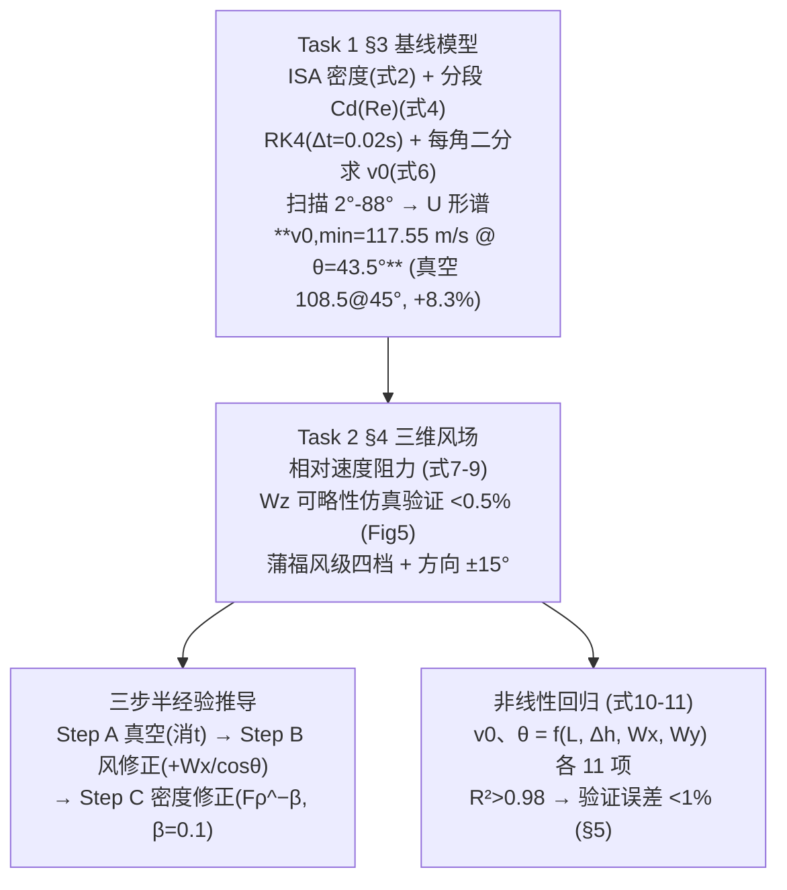

# 2025-GM-B-264（2025 题B · 队伍 264 · 27 页）

## 来自赏析

### 论文速览

论文以"最小初速"为解题主线：问题一在 500 m 海拔、1200 m 等高无风条件下，用 RK4 求得最小发射速度 $v_{0,\min}=117.55$ m/s、最优仰角 $43.5°$（真空理想值为 108.5 m/s、$45°$，阻力使所需初速增加约 8.3%）；问题二把模型扩为含风三维方程，用数值实验证明垂直风分量可忽略（落点偏差 <0.5%），再用蒲福风级把风速/风向离散化，最后通过"真空公式 → 风修正 → 密度修正"三步解析推导加非线性回归，得到只含初等运算的半经验公式（式 10/11，$R^2>0.98$），供无计算器军官手算 $v_0$ 与 $\theta$。

### 获奖密码

1. **解题切口独特**：把问题一的"什么初速和角度"诠释为"最小初速 + 对应角度"，并用"节约弹药"的战术逻辑自洽支撑，问题因此从求根变成优化，出结论更锐利。
2. **阻力模型处理展示物理判断力**：不是无脑套公式，而是指出 Morrison 关联的 $Re$ 适用上限、构造延拓、再用中值思想压缩为 $C_D=0.15$，把"简化"本身写成论证。
3. **每个简化都有数值实验背书**：垂直风忽略用三组对照仿真（<0.5%），风修正精度给了 3% 的量化声明，符合 UPC"验证文化"。
4. **历史情境嵌入模型**：蒲福风级离散化让"军官如何估风"成为模型输入端的一部分，而非泛泛而谈。
5. **双轨速算方案**：既给三步解析修正（可手算、可讲物理），又给回归多项式（可快速插值），互为校验。

### 可借鉴清单

1. "最小初速 + 最优角"的优化式解题框架，适用于任何"确定发射参数"类题目，结论唯一且有意义。
2. 简化前先证伪：用一组对照数值实验（如垂直风开关）给降维假设定量背书，写法固定成本极低。
3. Morrison 球体 $C_D(Re)$ 关联 + 分段延拓 + 常数化的三段式处理，是球形弹丸阻力建模的现成模板。
4. 有效高度 $h_{eff}=(h_0+h_t)/2$ 处取密度、再乘幂律修正因子 $F_\rho$，是海拔修正的极简写法。
5. 速算公式回归时先做量纲/物理筛选，剔除无效变量（如平面问题中的 $W_y$），避免被评委追问。
6. 重视收尾细节：图注占位词"Caption"、代码与正文模型不一致这类低级失误在争金奖时可能致命。

## 来自精读

### 全文骨架



**为什么这个骨架好**：题目的真实交付物是"**给 150–200 年前无计算器的炮兵军官用的快速估算方法**"——本队把这一句读成了结构：高保真模型负责"对"，回归公式负责"能用"，中间用简化验证（Wz、蒲福离散）把两层的落差补齐。**" fidelity 层"与"usability 层"分离并各自验证**，是工程类题目的黄金结构。

---

### 建模决策链

| 决策 | 作者的选择 | 被放弃的替代 | 为什么 |
|---|---|---|---|
| 优化目标 | 最小初速（省弹药） | 固定 v0 求最大射程 | 题面"conserving materiel"的作战语境 |
| Cd | Morrison(Re)+外推→取 0.15 | 311 队分段 Cd(Ma)、765 队 Re–Ma 耦合 | 最小初速工况亚声速，Re 型够用；450 m/s 段失真 ⚠ |
| 大气 | ISA 实时更新 | 常密度/指数大气 | 500–2000 m 内便宜且准 |
| 数值 | RK4 Δt=0.02 + 二分 + 扫描 | 打靶法/优化器 | 单调性保证二分可靠，结构透明 |
| 风场 | 3D→2D（Wz<0.5% 验证） | 直接 2D 假设 | **先验证后简化**的示范 |
| 风输入 | 蒲福四档+±15° | 连续风速 | 19 世纪军官的可观测性 |
| 交付 | 回归式(10)(11) | 射表（311）/列线图（765） | 公式最轻但只剩 1% 精度容错 |

**独立复现审计汇总**（python 复算）：
1. 真空 108.48@45° ✓；主结果 **117.51 m/s@43.5° vs 论文 117.55**（RK4+Cd=0.15+ISA，0.03%）✓✓；+8.3% 增量 ✓。
2. **文-码分裂 ⚠⚠**：按式 (4) Morrison 全程复算得 v0(43.5°)=114.84 m/s（−2.3%）；只有按附录代码的"3e5–5e5 线性过渡→Cd=0.15 常数"才复现 117.55——**正文叙事（式 4 逐点更新）与代码（0.15 常数）不一致，主结果来自代码**。
3. Table 2 内部不一致 ⚠：20°/30°/60° 三点与两种 Cd 模型的复现均差 3–8%（且 134.5/134.2 的近对称可疑），仅 43.5° 一致——疑非同一轮计算产出。
4. Re 勘误：450 m/s → 3.3×10⁶（论文印 7.72×10⁶ ⚠）；108.5 m/s → 7.96×10⁵（印 7.72×10⁵ ⚠，ν 隐含 1.546e-5）；但 CD=0.11/0.16 两值与正确 Re 的 Morrison/扩展式一致 ✓。
5. 回归基线复算 118.29/43.64 ✓（+0.6%/+0.3%）；Wy 系数≈0 → 横风不改最小初速（结论未明写）。
6. 跨声速盲区：450 m/s=Ma 1.33 处真实球体 Cd≈0.9（波阻峰），式 (4) 给 0.17——对最小初速答案无影响，对"最大初速工况"严重低估阻力 ⚠。
7. 文字/排版瑕疵：Fig 6 caption 为占位符 "Caption" ⚠；结论末句截断（"The method is applicab."）⚠；§5.3 的 "within 1%" 印成 "12/13"（% 丢失）⚠；Table 3 与 §4.2 的 Wx 符号约定相反 ⚠。

---

### 可复用模板

**结构模板**：
```
1 Problem Analysis  历史语境 → 钉死交付物("无计算器的快速估算")
2 Assumptions       平滑球面/忽略横风翻滚/不可压缩/常 g
3 Task 1            力分析 → ISA + Cd(Re) 外推 → RK4+二分+扫描 → U 形谱+对照
4 Task 2            3D 风场方程 → 简化验证(Wz) → 离散化(蒲福) →
                    Step A/B/C 半经验框架 → 回归式 → R²
5 Verification      方案四步 → 无风先行 → 相对误差曲线 → <1%
6 Conclusions       "two-tier modeling framework" 方法论升华
A MATLAB            ⚠ 必须与正文模型一致
```

**句式库（原文英文句）**：
- "Guided by the operational objective of conserving materiel, the study focuses on the minimal muzzle velocity ..."（目标操作化句）
- "at small angles, longer flight times lead to greater drag loss, while at large angles, excessive vertical components increase gravitational energy loss"（U 形双端解释句）
- "Since CD varies slowly within this interval ..., we approximate its mean value by the mean-value theorem of integration"（变系数常化句）
- "The results ... indicate that the two trajectories almost overlap, with a maximum impact point deviation of less than 0.5%. This demonstrates that ... can be neglected"（简化验证标准句）
- "Physically, this correction restores the horizontal velocity component to its vacuum equivalent. The simplified form maintains accuracy within 3%"（修正项物理意义+精度声明句）
- "This 'two-tier' modeling framework can serve as a reference paradigm for other historical engineering problems."（方法论升华句）

**图表配方**：U 形谱+真空对照线；简化合法性三联对比图；Cd 模型+实验数据同图；仿真 vs 公式的趋势叠图+误差曲线收口。

---

*对照阅读：`05_论文赏析/2025/2025-GM-B-264.md` 与 `07_题目解读/2025_题B_火炮弹道射表.md`（南理工五队谱系与 Cd(Ma) 胜负手讨论）；同题队友精读：`2025-GM-B-127_精读.md`、`2025-GM-B-496_精读.md`、`2025-GM-B-311_精读.md`（分段 Cd(Ma) 路线，恰补本篇跨声速盲区）。*
