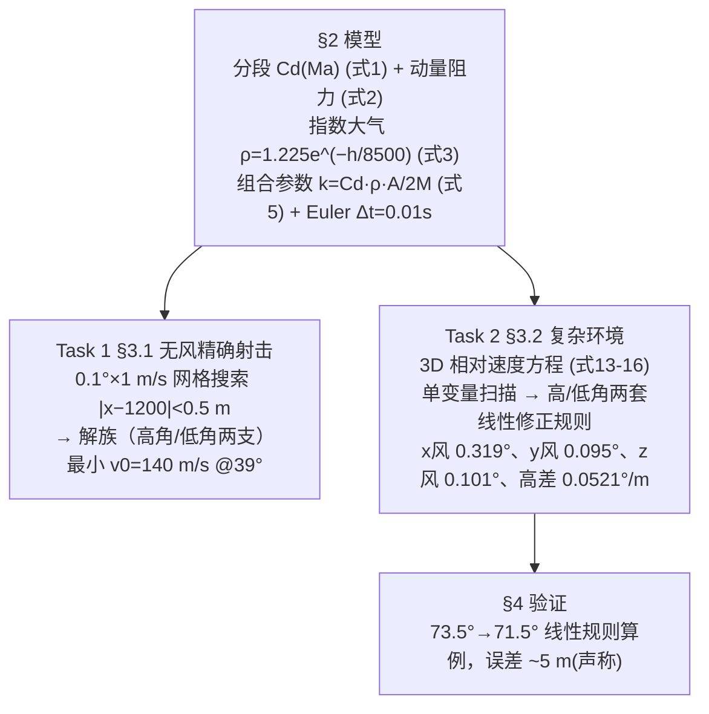

# 2025-GM-B-311（2025 题B · 队伍 311 · 17 页）

## 来自赏析

### 论文速览

论文建立二维/三维弹道数值模型：阻力采用按马赫数分段的工程经验公式 $C_d(Ma)$（式 1），密度用指数模型 $\rho=1.225e^{-h/8500}$（式 3），以 Euler 法（$\Delta t=0.01$ s）离散求解。问题一用步长 0.1°/1 m/s 的轨迹搜索算法给出 1200 m 目标的"多解族"——表 2 显示从 $3°:448$ m/s 到 $82°:389$ m/s 共 14 组解，最小初速约 140 m/s（$39°$）；问题二固定 $v=300$ m/s 演示，对风沿 x/y/z 轴、距离、高程差逐项做敏感性扫描，提炼出"每 1 m/s 纵风修正 0.319°（高角）/0.0121°（低角）"式的线性炮管修正规则，并用一个随机算例验证修正后落点误差约 5 m。

### 获奖密码

1. **"多解族"呈现方式**：不满足于给一组解，表 2 + 全弹道图把 $v_0(\theta)$ 的 U 形结构、飞行时间 tradeoff 一并呈现，展示了对问题结构的完整理解。
2. **阻力公式选型贴合球弹**：分段 $C_d(Ma)$ 钝体公式抓住了 450 m/s 跨声速的关键物理，且形式简单、可直接手算插值。
3. **修正规则具体到"每单位扰动多少度"**：高/低角双套斜率直接就是可执行的炮兵口诀，实用性讨好评委。
4. **验证算例诚实**：给出 5 m 误差并分析来源（线性化 + 距离因子相关性低），不粉饰。
5. **模型评价章节完整**（Strengths/Weakness/Applicability + 改进路线），显示出成熟的方法论自觉——在篇幅极短的情况下保住了结构完整性。

### 可借鉴清单

1. 轨迹搜索 + 多解表格（角度-初速-落点-飞行时间四列）是展示"弹道问题多解性"的现成模板。
2. 分段 $C_d(Ma)$ 公式（0.47 → 跨声速峰 1.22/(1+0.35(Ma-1)²) → 0.95）适合球/钝体弹丸的快速建模。
3. 修正规则输出为"每 1 m/s 或每 1 m 变化多少度"的线性敏感度，配上高/低角两种工况，是最轻量的"射表"。
4. 每个模型都写明适用范围（中距、标准大气、非极端环境），为简化假设提供免责边界。
5. 引入常数合并参数 $k$ 可让推导更紧凑，但阻力分解务必用 $-k\,v\,\vec v$ 的正确形式。
6. 排版细节决定印象分：图注错字、节标题重复、汇总条目复制粘贴错误在 17 页短文里会被成倍放大。

## 来自精读

### 全文骨架



**为什么这个骨架好**：全文只做一件事——把数值弹道**蒸馏成五条口诀**。任务 1 给解族（证明多解存在并选最小），任务 2 给规则（可直接执行）。没有回归式、没有射表、没有列线图，是六队里交付物最"轻"的：**当你只有 17 页时，把一个可执行的产品做到干净，比铺三个半成品强**。

---

### 建模决策链

| 决策 | 作者的选择 | 被放弃的替代 | 为什么 |
|---|---|---|---|
| 阻力模型 | 分段 Cd(Ma)（4 段） | 264 队 Morrison(Re)+0.15、765 队 Re–Ma 耦合 | 抓住跨声速峰——但亚声速段取 0.45 与 smooth 假设冲突 ⚠ |
| 数值方法 | Euler Δt=0.01 | 264 队 RK4 Δt=0.02 | 简单透明；自认累积误差（§5.3 换 RK4） |
| 搜索 | 0.1°×1 m/s 网格 + ±0.5 m 窗口 | 二分/打靶 | 简单；但**窗口命中≠最小 v0** ⚠ |
| 交付形态 | 线性敏感度规则（两套） | 回归式（264）、射表（392/428）、列线图（765）、括射（496） | 最轻、最可执行；牺牲精度（算例 5–15 m） |
| 验证 | 单算例端到端 | 264 队 12 组样本+误差曲线 | 便宜；但算例数字对不上 ⚠ |

**独立复现审计汇总**（python 复算）：
1. 式 (1) 断崖确认（以 PDF 原式为准）：Cd(0.79)=0.372 → Cd(0.81)=1.205；Cd(2.49)=0.687 → Cd(2.51)=0.950 ⚠⚠；亚声速段随 Ma 下降与物理相反 ⚠。
2. **式 (7) 分量平方阻力物理不成立**（下落段加速、无终端速度）；与 Q2 式 (13) 的正确形式内部矛盾 ⚠⚠。
3. 表 2 复现：39° 最小值——印刷式 135.4 / 正确式 141.3 / 论文 140（与正确式差 −0.9% ✓）；但 15–72° 全表数值介于两实现之间，且 ±0.5 m 窗口判据使各行并非严格最小 v0（落点 1199.67–1200.50 振荡为证）⚠。
4. 82° 高角解：正确模型下即使 v0=500 m/s 也无法及 1200 m（论文给 389 m/s）⚠——高角端的表 2 数值与正确阻力模型不相容。
5. 验证算例：落点 (1110.98, 100.28) vs 目标 (1095.54, 100) → 纵向误差 **15.4 m**，论文称 "about 5m" ⚠ 数字不符；基线落点 (995.54, 1.97) 的 1.97 m 侧偏来源未说明。
6. 排版硬伤清单：规则 4/5 文字重复 ⚠；规则 3 方位/俯仰混写 ⚠；Fig 5 caption "Y-axis"（应为 Z）⚠；Fig 17 caption "Low-angle"（实为 73.5° 高角算例）⚠；§5.1/§5.2 标题同为 "Refine Aerodynamic Model" ⚠；表 2 末行（82°）缺到达时间。
7. 跨队对照：同题最小初速 264=117.55@43.5°（Cd=0.15）vs 311=140@39°（Cd≈0.45）——**Cd 的亚临界/超临界之争直接贡献了答案谱的左右两端**；311 的跨声速峰建模在"最大初速 450 m/s"工况下明显更物理，264 的光滑球超临界取值在"最小初速"工况下更自洽——两队各对一半。

---

### 可复用模板

**结构模板**：
```
1 Problem Analysis  参数敏感性叙事 + 题面钉死
2 Model             11 条假设 + 符号表(k 单位=1/m) + 式(1)-(12)
                    2.3.1 Q1 推导(2D) / 2.3.2 Q2 推导(3D 风)
3 Results           3.1 无风解族(U形谱+表2) 3.2 敏感度规则(高低角两套)
4 Validation        单算例端到端(规则→仿真→误差)
5 Model Improvement 4 条升级路线(连续Cd/时变风/RK4/科氏)
6-7 Evaluation+Conclusion  强弱项+适用域(1000-1500 m 标准大气)
```

**句式库（原文英文句）**：
- "To simplify the equation, the constant terms unrelated to velocity are combined into a single parameter, denoted as k."（组合参数句）
- "Due to the inability to display all results obtained with a step size of 0.1°, the results obtained with a step size of 1° are presented in the table below"（数据裁剪声明句）
- "During the solving process, we found that for a given point, there would be a solution with a high emission angle and a solution with a low emission angle."（解族发现句）
- "For every 1 m/s increase in the x-axis component of the wind, the gun barrel is raised by 0.319° at high elevation angles and lowered by 0.0121° at low elevation angles"（规则句式——注意"raised/lowered"的方向必须无歧义）
- "Taking into account factors such as rough estimation on the battlefield, the error is within an acceptable range."（误差豁免句——先给数字再给豁免理由）
- "Lack of experimental validation data; the model's accuracy relies solely on theoretical derivation and simulation."（短板自报句）

**图表配方**：分段函数+断点标注；解族轨迹叠图（同一落点）；"扫描曲线+线性拟合"成对出现（规则的生产线）；端到端验证算例图。

---

*对照阅读：`05_论文赏析/2025/2025-GM-B-311.md` 与 `07_题目解读/2025_题B_火炮弹道射表.md`（南理工五队谱系、Cd(M) 胜负手与横风漂移量级）；同题队友精读：`2025-GM-B-264_精读.md`（Morrison+0.15 与三步半经验公式——与本篇构成 Cd 分歧的两极）、`2025-GM-B-127_精读.md`、`2025-GM-B-496_精读.md`。*
