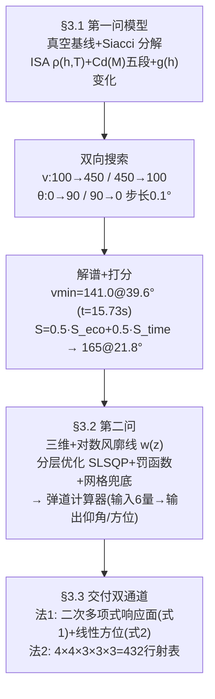

# 2025-GM-B-392（2025 题B · 队伍 392 · 33 页）

## 来自赏析

### 论文速览

论文构建"高保真数值模型 → 弹道计算器 → 双轨速算方案"三层递进体系。问题一用双向搜索（初速 100–450 m/s、角度 0.1° 步长）得到多解族：最小能量解 141.0 m/s @ 39.6°，并自创"经济性+时间"归一化评分函数 $S_{final}=0.5S_{eco}+0.5S_{time}$ 推荐折中解 165.0 m/s @ 21.8°（飞行 11.41 s）；问题二引入对数风廓线与分层优化（SLSQP+罚函数，失败则退化为细化网格搜索），做成六输入两输出的"弹道计算器"；问题三给出函数拟合法（二次多项式回归，相对误差约 12.2%/21.9%）与查表法（4×4×3×3×3=432 行射表）供无计算器军官二选一。

### 获奖密码

1. **对数风廓线建模风切变**：以 $z_0=0.1$ m、$\alpha=0.143$ 的边界层气象公式替代均匀风，是 9 篇中唯一认真处理"风随高度变化"的队伍，物理纵深突出。
2. **决策科学化**：用归一化评分函数把"多解怎么选"变成可计算的问题（经济 vs 时间 0.5/0.5 加权），比单纯给最小初速更接近真实指挥决策。
3. **计算器工程化**：六输入二输出、带精度分级提示（error<10 m 高/<50 m 中/否则低）的交互式程序，把"模型"做成了"工具"。
4. **双轨速算 + 诚实误差**：函数法（准）与查表法（快）并列让军官自选，并如实报告 12–22% 误差与改进方向，符合竞赛对 self-critique 的偏好。
5. **重力梯度、Siacci 近似等细节**堆叠出"懂弹道学"的专业形象。

### 可借鉴清单

1. 对数风廓线 + 幂律上延是风场建模的高级模板，公式一行、收益显著。
2. 多解选择问题用归一化评分函数（$S=(x_{max}-x_{self})/(x_{max}-x_{min})$ 加权）泛化成通用决策框架。
3. "优化失败自动降级为网格搜索"的鲁棒算法结构值得在任何反解类问题中复用。
4. 约束反解统一写成罚函数 + 误差泛函，比逐情形写 if-else 优雅。
5. 射表维度爆炸时固定最可控变量（如 $v_0=450$）压缩表格规模，并说明理由。
6. 附录代码务必清理非 ASCII 字符与调试残留，中文字符串乱码会直接拉低印象。

## 来自精读

### 全文骨架



**为什么这个骨架好？** 它是七篇中唯一把第二问当成**"监督学习"问题**来解的：高保真模型当"数据生成器"，回归公式/射表当"轻量代理模型"（surrogate）。这个 framing 天然带出三个别人没有的要素：训练集规模讨论（20 vs 100 组）、独立测试集 MAE、以及"精度优先还是速度优先"的双通道交付。代价是泛化误差（自报 12–22%）——但**报了就比不报强**。

---

### 建模决策链

| 决策 | 作者的选择 | 被放弃的替代 | 为什么 |
|---|---|---|---|
| Cd 模型 | 五段线性 Cd(M)，峰 0.7 | 常数（155/428）、Loth（207/188） | 折中保真度与实现成本 |
| 重力 | g(h) 随高度变 | 常数 g（其余各队） | 影响微小但"写进代码" |
| 风 | **对数风廓线**（全场唯一） | 均匀风（其余六队） | 边界层物理；低伸弹道下为二阶小量 |
| 求解 | 双向单调扫描 | 穷举（155）、fsolve 多起点（204） | 实现最简；自认 vmin 偏大 |
| 选解 | 归一化打分 0.5/0.5 | 单判据（最速/最省） | 多目标显式化（⚠ 与实际推荐不符） |
| 第二问 | 优化器+罚函数+网格兜底 | 打靶/二分 | 方位角需二维优化 |
| 交付 | 响应面公式 + 432 行表 双通道 | 单一射表（207/428） | 精度/速度分离；各自报误差 |

**独立复现审计汇总**（Python+scipy，RK45，其 ISA+五段 Cd+g(h) 模型）：
- **v_min=141 m/s @39.6°：精确复现 ✓✓**（复算落点 1201.5 m、t=15.74 s vs 论文 15.73 s，差 0.01 s——七篇中最精确的一次单点复现）。
- 均衡解 165@21.8°：射角 ✓（复算 21.73°），飞时 ⚠ 复算 10.87 s vs 论文 11.41 s（差 5%）。
- θ(450) 低支 3.06° ✓（论文 3.1°）。
- **⚠ 打分函数不自洽**：按其等权准则复算，最优在 v≈220–226 m/s（S≈70.1），论文推荐 165 m/s（S≈62–65）——"推荐解"与"选解准则"脱节。
- **⚠ 式 (1) 缺 a₁₄ 系数、特征量纲未声明**：按已给系数无法复现其示例（9.0–9.4° vs 8.02°）；其自报 MAE（12.2%/21.9%）与复算偏差量级一致，方法定位诚实。
- ⚠ 口径矛盾三连：正文风向 0°=顺风 vs 代码注释 0°=逆风；摘要风向 60° vs 正文示例 −60°；R* 正文 8.21432 vs 代码 8.31432。
- ⚠ 示例 1（v₀=141 → 43.59°）与其第一问答案（141.0@39.6°）不自洽——v_min 附近可行域为单点，优化器收敛位置敏感。
- 工艺小注：第一问用 Euler dt=0.01 s、第二问用 RK4——同文两套积分器，第一问结果未用高阶法复核。

---

### 可复用模板

**结构模板**：
```
1 Introduction   背景/重述(三目标: 核心计算→扩展→方法)
2 Assumptions    6条(排除项带自己场景的数字)
3.1 Q1           解析基线→Siacci→ISA/Cd(M)/g(h)→双向搜索→解谱→打分选解
3.2 Q2           罚函数+分层优化→对数风廓线→计算器I/O→5个算例→三视图
3.3 Q3           法1响应面(特征工程+系数表+MAE自报) 法2射表(432行构成式)
4 Evaluation     4 strengths / 3 weaknesses(含"搜索vmin偏大"的自我暴露)
5 Conclusions    按三问逐条给 Q&A 式总结
Appendix         双 Python 类(CannonBallistics/WindBallistics) 全码
```

**句式库（原文英文句）**：
- "The core advantage of this method lies in transforming complex ballistic calculation problems into simple algebraic operations, significantly enhancing computational efficiency while maintaining high prediction accuracy..."（响应面定位句）
- "They can choose the more accurate or simpler method according to their needs."（双通道取舍句）
- "our bidirectional search algorithm yields the first velocity that strikes the target's right side, resulting in the searched minimum initial velocity being larger than the true minimum velocity."（自我暴露式缺点报告）
- "The entire process embodies the effective integration of physical models and data-driven methods, ensuring that the model retains physical significance while being computationally simple."（物理+数据融合的总结句）
- "A logarithmic wind profile simulated altitude-dependent wind speed, and a hierarchical optimization algorithm minimized impact errors."（摘要级方法句）

**图表配方**：多目标选解 → "归一化子评分叠画 + 候选解竖线标注"；三维弹道 → "Top/Side/Front 三视图一图三联"；代理模型 → "训练集规模-精度标度图（20 vs 100）+ 随机抽检表"。

---
*对照阅读：`05_论文赏析/2025/2025-GM-B-392.md`、`07_题目解读/2025_题B_火炮弹道射表.md`；均匀风与廓线风的差异对照 188（精读 62）式 (4-29)；Cd 四档保真度总览见本篇 §3.2 数值感。*
