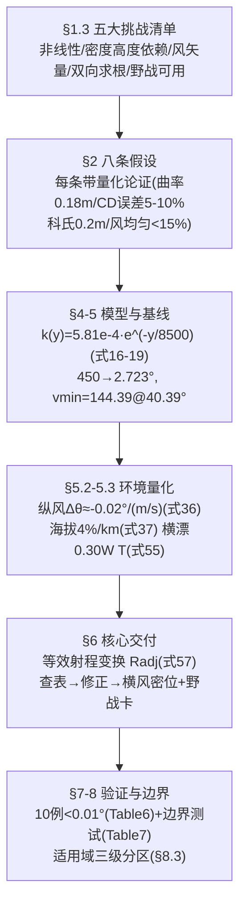

# 2025-GM-B-428（2025 题B · 队伍 428 · 32 页）

## 来自赏析

### 论文速览

论文以"标准射表 + 三条线性修正"为核心交付一套纯手算速射方法：基准弹道用二次阻力（工程常数 $C_D=0.50$）+ 指数大气（$H=8500$ m）+ RK4（$\Delta t=0.001$ s）求解。问题一给出完整解谱：满装药 450 m/s 只需 2.723° 仰角（3.78 s、末速 233 m/s），最小速度高抛解 144.39 m/s @ 40.39°（14.2 s、弹道高 246 m）。速算方法把实际条件折算成"等效射程" $R_{adj}$ 查表，配海拔（±4%/km）、纵风（系数 0.8）、横风偏流（$300W_\perp T/R$ 密位）三条修正，验证显示角度误差均值 0.001°、最大 0.010°（<0.16 mil），射程误差 <0.2%。

### 获奖密码

1. **"等效射程变换"是速算方法论上的最优解**：不修正角度而修正射程，把多变量修正压缩成"除以两个因子再查表"两步操作，1–2 次迭代即可收敛，工程上极为优雅。
2. **每条经验系数都"先推导后标定"**：先给出理论值（11.8%/km、系数 2），再解释数值拟合值（4%/km、0.8）为何更小，理论与数值互相印证，评委无法质疑系数来源。
3. **验证体系完整且有统计味**：均值/标准差/最大误差、hexbin 对角线图、边界工况、失效模式（横风 >20 m/s），自评精度（0.16 mil）甚至优于火炮固有散布（±10 m）形成闭环论证。
4. **假设定量化的写作范式**：8 条假设 = 8 个数量级验算，把"简化"变成"论证"。
5. **交付物齐全**：两张射表 + 一页野战卡 + 口诀 + 适用域边界表，"可用性"维度几乎满分。
6. **文献专业**（McCoy、Carlucci、G1/G7 讨论），并与现代弹道学（六自由度、蒙特卡洛）做定位比较，摆正自身价值。

### 可借鉴清单

1. "等效射程/等效条件变换 + 查表"是所有 UPC 速算题的黄金框架，比逐项修角度更稳。
2. 假设逐条配数量级验算（曲率 0.18 m、科氏 0.2 m、Magnus 为零），成本一页纸，收益极大。
3. 经验修正系数用"理论推导给量级 + 数值拟合定终值 + 解释差异"三步走。
4. 误差验证输出"均值/标准差/最大值 + 90%/99% 分位带"，比单点对比高级得多。
5. 论文末尾给"适用域三档表"（最优/精度退化/不适用），主动划定边界显得专业。
6. 附录放一张"野战速查卡"（一张小表 + 三条口算规则），直接回应题目的"军官手算"场景。

## 来自精读

### 全文骨架



**为什么这个骨架好？** §1.3 的"挑战清单"与 §8.3 的"适用域分区"首尾呼应：开头声明"难在哪"，结尾声明"我的方法在哪好、哪退化、哪不能用"。多数论文只做前者；**敢画"不适用区"的方法才有资格被称为工程方法**。另一条暗线：每个修正系数都写了两遍——先推导理论值，再数值标定，并解释两者为何不等（如海拔修正理论 11.8%/km vs 实际 4%/km）。这种"推导-标定-解释偏差"三段式是全文最值得抄的方法论。

---

### 建模决策链

| 决策 | 作者的选择 | 被放弃的替代 | 为什么 |
|---|---|---|---|
| C_D | 常数 0.50（自报 5–10% 误差） | Cd(M)（204/207/188） | 误差<其他源；换可解释性与查表稳定 |
| 大气 | 指数 ρ₀e^{−h/8500} | ISA（188/392） | 1 km 内 <5%；k(y) 解析 |
| 求解 | RK4 + brentq 双支 | 穷举（155）、fsolve（204） | 精度与速度均衡 |
| 修正结构 | **等效射程变换 + 三线性修正** | 逐项角修正（188）、修 v₀（204） | 一次查表完成射程类修正 |
| 系数出身 | 理论推导+数值标定+偏差解释 | 纯拟合（155）、纯差分（204） | 每个系数可追责 |
| 验证 | ground truth 对照+边界测试+hexbin | 盲测（155）、箱线图（207） | 覆盖设计域与边界域 |
| 边界 | 三级适用域分区 | 只给适用范围一句话 | 全场唯一"不适用区" |

**独立复现审计汇总**（Python+scipy，其自身模型：C_D=0.5、ρ=1.225e^{−h_abs/8500}、RK45 rtol 1e-10）：
- 基线解 (450, 2.723°)：射程 1200.6 m ✓、T=3.780 s ✓、落速 233.3 m/s ✓、y_max=17.5 m（与正文 17.7 ✓；**⚠ Table 9 给 19.2 m，与 Table 4 的 17.7 同文矛盾**）。
- 射表 Table 4 四点抽查（1000/1100/1300/1500 m）：2.074/2.384/3.086/3.913 vs 论文 2.074/2.385/3.089/3.920 ✓✓（差 ≤0.007°）。
- v_min：复算 ~145 m/s vs 论文 144.39 ✓（扫描粒度内）。
- **✗ Table 5/野战卡减装药列错误**：复算 300 m/s 命中 1200 m 需 6.16°，论文给 11.58°；且与其自身 Fig 1（217.9 m/s→12°）矛盾——300 m/s 低支角必小于 12°。
- **✗ 式 (36)（Δθ=−0.02°·W∥）与式 (49)/(57) 链条相差 3 倍**：复算顺风 +20 → −0.132°，Radj 法 −0.14 ✓，式 (36) −0.4 ✗。
- ⚠ 摘要"25 m/s crosswind produces 300 m lateral drift"系笔误（Table 8 真值 24.6 m；量级应为 ~25–30 m）。
- ⚠ 正文"terminal velocity 233 m/s remains supersonic (M≈0.68)"——0.68 是**亚**声速，标签写反。
- ⚠ 式 (31) 步长判据代入得 0.177 s≠0.002 s（结论对、公式是包装）；式 (18) 中间值 5.81×10⁻³ 与 (19) 的 10 倍不符。
- ✓ 加分项确认：等效射程算例五步算术全对；"233/450→动能保持 27%"与 Table 9 的 26.8% 自洽；hexbin 验证图是全场唯一。

---

### 可复用模板

**结构模板**：
```
1 Problem Analysis  背景例数(Re/Ma 先算)→任务分解 A/B/C→五大挑战清单
2 Assumptions       8条编号假设,每条=结论+数字+对照物+适用出口
3 Notation          物理量+状态量双表
4 Model             4.1 阻力细推导(从相对速度写起)+k(y)+阻力长度
                    4.2 RK4+步长+落点插值
5 Results           基线双解→解谱图→环境量化(风/海拔)→双装药射表
6 Rapid Method      原理(等效射程)→三修正双重出身→五步流程→算例→口诀
7 Validation        ground truth 对照(10例)+边界测试+横风专项
8 Improvements      改进公式(Cd(M)/BC/分层/风切变)+三级适用域
9-10 S&W/结论       6+6条,对称收尾
Appendix            全码+完整射表+野战卡
```

**句式库（原文英文句）**：
- "Core Concept: Convert the target range R under actual conditions ... into an equivalent standard range Radj, then look up the standard table ... to obtain elevation angle θ0, and finally apply wind drift corrections."（方法总纲）
- "However, numerical calculations show the actual correction coefficient is approximately 4%/km, because: 1. ... 2. ..."（理论-标定偏差的解释句式）
- "While strictly speaking the ballistic equations are nonlinear, this approximation is reasonable within engineering accuracy requirements."（线性叠加的自辩）
- "Applicability Note: For our target distances of 1000–1500 m, the maximum curvature-induced error is about 0.1 m, far smaller than artillery's inherent dispersion (±10 m)."（假设的对照物句式）
- "Under resource-constrained conditions, clever physical approximations and engineering simplifications often have more practical value than precise but complex numerical methods."（全文的价值观宣言）

**图表配方**：修正方法 → "三口径对账图（仿真 vs 理论 vs 标定）"；验证 → "六联验证图+hexbin 密度图"；交付 → "可打印野战卡（表+三行修正+口诀）"；解谱 → "双支曲线+vmin 交点标注"。

---
*对照阅读：`05_论文赏析/2025/2025-GM-B-428.md`、`07_题目解读/2025_题B_火炮弹道射表.md`；等效变换 vs 逐项角修正（188，精读 62）vs 修 v₀（204，精读 63）vs 一步修正（460，精读 67）——四种"无计算器"架构的总对照。*
