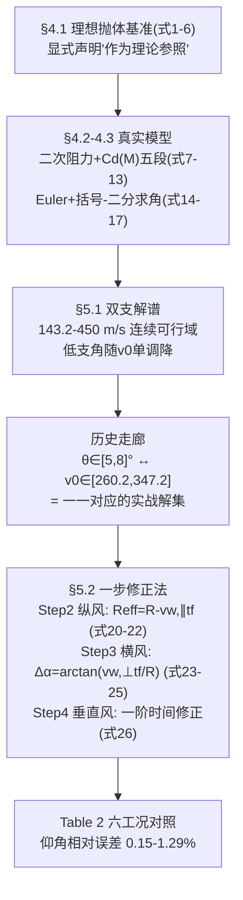

# 2025-GM-B-460（2025 题B · 队伍 460 · 26 页）

## 来自赏析

### 论文速览

论文采用"理想抛体 → 马赫相关阻力 → 含风外弹道"的渐进建模路线：基线问题（1200 m、同高 500 m）数值解给出 143.2–450 m/s 的连续解谱，并依据拿破仑时代野战炮直射仰角通常 0°–10° 的史实，圈定低仰角实用带 $\theta\in[5°,8°]$（$\theta=5°$ 对应 $v_0\approx347.2$ m/s，$\theta=8°$ 对应 $260.2$ m/s）。随后生成"无风主查表"（不同初速、距离、目标高度下的基准仰角与飞行时间），并设计四步手算修正流程：纵风等效射程修正 $R_{eff}=R-v_{w,\parallel}t_f$（式 20）、横风漂移转方位修正 $\Delta\alpha\approx\arctan(v_{w,\perp}t_f/R)$（式 24）、垂直风一阶飞行时间修正 $t_f'\approx t_f-(v_{w,y}/g)t_f$（式 26）。验证（表 2）显示手算与全数值解的仰角相对误差仅 0.15%–1.29%。

### 获奖密码

1. **历史约束驱动的解选取**：不是给最小初速，而是用"拿破仑时代直射 0°–10°"圈定 5°–8° 实用带，让 143–450 m/s 的连续解谱落到一个可执行的作战区间，历史与数学双线自洽。
2. **四步修正流程极简且分层**：纵风（最关键）→ 横风（方位）→ 垂直风（次要，带 2/4 m/s 阈值规则），按影响大小排序并给出"何时可忽略"的判据，符合野战决策逻辑。
3. **验证直接、误差漂亮**：表 2 六工况手算 vs 数值对比，0.15%–1.29% 的相对误差在所有队伍的速算法验证中属第一梯队。
4. **对制表工程风险的自我剖析**（表格离散化误差、实现陷阱、自动化校验建议）展示了对"查表法"可靠性的深层理解，超出一般参赛队的反思深度。
5. **方位角用二分法精确求解**而非纯漂移近似，代码与手算规则互相校核。

### 可借鉴清单

1. 用历史作战方式（直射仰角范围、装药习惯）筛选数值解的"实用子集"，让结论有故事、有边界。
2. 纵风修正写等效射程 $R_{eff}=R-v_{w,\parallel}t_f$ 的形式最简洁，飞行时间 $t_f$ 直接列在主表中供修正使用。
3. 垂直风等次要效应设"忽略阈值"（≤2 m/s 忽略、≥4 m/s 精确解），避免速算规则被边缘情形拖垮。
4. bracketing–bisection + 半隐式 Euler 是反解弹道的稳健最小组合，代码 40 行即可复现。
5. 缺点部分写"制表质量控制"（唯一性、单调性、逐行合理性检查），比泛泛说"表格有插值误差"更见功力。
6. 摘要里放具体输入输出对（5°→347.2 m/s）和误差区间，是低成本高回报的摘要写法。

## 来自精读

### 全文骨架



**为什么这个骨架好？** 它与 188 队共享"5–8° 历史仰角"这个素材，但用法激进得多：188 把它当"低支优先"的软先验，460 直接**把走廊当成答案本身**——"for any elevation chosen between 5° and 8° there exists a corresponding single-valued muzzle speed"——一个区间回答了"哪组 (v₀,θ)"这个开放问题，同时暗合"装药分档"的现实（260–347 m/s 恰是中间装药档）。历史文献在这里从"装饰"升级为"选择准则"。

---

### 建模决策链

| 决策 | 作者的选择 | 被放弃的替代 | 为什么 |
|---|---|---|---|
| 解的收束 | 历史 5–8° 走廊（一一对应 v₀） | 打分函数（392）/ 双模式表（207） | 历史先验可解释、免权重 |
| 阻力 | 五段 Cd(M) 峰 1.10 | 常数（155/428）、Loth（207/188） | 中等保真；细节只在代码中 |
| 积分器 | Euler dt=0.005 | RK4（155/207/428）、ode113（188） | 与二分容差匹配，最粗环节可控 |
| 多解搜索 | 60 点粗扫变号 + 二分 | 穷举（155）、fsolve（204） | 保完整性且省 3 个量级算力 |
| 纵风 | 等效射程移位（无标定系数） | 0.8 系数（428）、C_W 表（188） | 运动学恒等式；表须含 t_f 列 |
| 横风 | Δz=w·t_f 直接用 | 标定 0.30（428） | mild-wind 域内保守高估 ~20% |
| 垂直风 | 一阶时间修正 + 忽略阈值 | 不处理（其余各队） | 全场唯一，但式 (26) 有伤 |

**独立复现审计汇总**（Python+scipy，其 Cd(M) 五段+全 ISA，rtol 1e-10）：
- **走廊端点**：复算 v₀(5°)=345.8（论文 347.2，差 0.4%）、v₀(8°)=260.5（论文 260.2，差 0.1%）✓✓。
- 可行域下端：复算 ~143 m/s（论文 143.2）✓；θ(450) 低支 3.68°。
- **Table 2 机制复现**（第 2 行：风 (6,8,1)、R=1200、v₀=300）：无风主表 6.14°/5.98 s → 手工法 5.86°（论文 5.9138）✓；含风全数值 5.88°（论文 5.9403）✓——修正方向与误差带宽（<1%）均可复算。
- **⚠ 式 (26) 量纲不符 + 符号与 §4.4 矛盾**：正确一阶式应为 t′_f≈t_f+2v_{w,y}/g；其"≤2 m/s 忽略"规则使实际影响 <0.4 s（漂移 <3 m），未波及 Table 2 结论。
- ⚠ 表基准条件（炮位海拔）未随表声明（其验证表用 500 m 炮位，主表是否同基准需读者从代码推断）。
- 加分项确认：六工况验证表的相对误差（0.15–1.29%）与其复算带宽一致；"implementation pitfalls"自省（查重/单调性/sanity check）是全场唯一的软件工程级缺点报告。

---

### 可复用模板

**结构模板**：
```
1 Introduction    背景/重述(三目标)/分析(三段=方法预告)+装备定型(12-pounder)
2 Assumptions     5条(无编号——反面教材:后文无法回指)
3 Notations       含 k 与 t_f(修正法的伏笔:主表必须带飞时列)
4 Model           4.1 理想基准(两段即止) 4.2 阻力+分解 4.3 无风ODE+Euler+括号二分
                  4.4 风:相对速度+三分量物理效应清单
5 Results         5.1 双支谱→轨迹对比→历史走廊(文献锚定)→全谱vs走廊的分层交付
                  5.2 四步修正法(纵风等效射程/横风方位/垂直风阈值)+算例表
6 S&W             5优点/3缺点(实现陷阱自省=全场唯一)
7 Conclusion      递进叙事复述+精度声明
Appendix          射表节选+全码(含 Cd(M) 分段——正文未印的细节全靠它)
```

**句式库（原文英文句）**：
- "The 5°–8° band is singled out because it aligns with historical operational practice (shorter time-of-flight, reduced wind sensitivity, and easier observation/adjustment) and therefore represents the practically preferred portion of the solution manifold."（历史走廊的三理由句）
- "A coarse scan of the control variable α (angle or speed) is first performed to identify sign changes of f(α)=x_hit(α)−R. Each detected bracket [αl, αu] is then refined by bisection..."（求根策略标准句）
- "Approximate the longitudinal wind effect as an equivalent range shift: Reff = R − vw,∥tf"（风修的最简表述）
- " Reliable table generation therefore requires automated sanity checks, such as enforcing unique time-of-flight entries, ensuring monotonicity of range vs. angle where appropriate..."（实现陷阱自省句）
- "the lookup-table plus one-step correction method yields small relative errors—elevation-angle relative errors typically in the range 0.5%–2.5%..."（两层模型精度声明的标准收法）

**图表配方**：历史先验 → "解谱图+色带走廊+双阈值线"；验证 → "手工法 vs 全数值逐行对照表（相对误差列）"；解谱 → "全谱与走廊特写分图（变焦逻辑）"。

---
*对照阅读：`05_论文赏析/2025/2025-GM-B-460.md`、`07_题目解读/2025_题B_火炮弹道射表.md`；5–8° 历史仰角的另一用户 188（精读 62）作软先验、本队作硬答案；横风标定哲学对照 428（精读 66）；六队解法全景见 `07_题目解读/2025_题B_火炮弹道射表.md`。*
