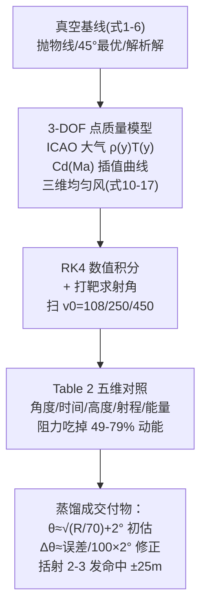

# 2025-GM-B-496（2025 题B · 队伍 496 · 27 页）

## 来自赏析

### 论文速览

论文采用"真空解析基线 → 3-DOF 质点弹道仿真 → 军官野战手册"的双重结构：模型包含 ICAO 标准大气、马赫相关 $C_d(M)$ 插值曲线与风矢量，用 RK4（实为 `solve_ivp`，$\mathrm{rtol}=10^{-8}$）积分加求根获得精确射角。核心结果以"真空 vs 真实"对照表（表 2）呈现：450 m/s 超声速弹射角从真空 1.67° 升到 3.36°（+101.2%），250 m/s 从 5.42° 升到 8.73°，108.44 m/s 反而降 6.3%；若按真空解射击，射程误差达 334–449 m，阻力能量损失 49%–78.6%。最终交付"Royal Artillery Field Manual"式速算体系（经验规则 + 试射括 shooting 法），宣称野战精度 ±25 m、2–3 发命中。

### 获奖密码

1. **"真空 vs 真实"对照表是全场最佳论证之一**：表 2 同时给出角度、时间、弹道高、射程误差、能量损失五个维度的百分比变化，把"阻力是主导效应"从口号变成五组硬数字。
2. **无计算器方法被量化定价**：表 4 的"发数-精度-训练成本"三角对比，把题目要求的"军官方法"放进了真实作战效能框架，回应题意的深度超出纯物理建模。
3. **括射（bracketing）修正规则**：±1.5/3/5/8° 分级修正表直接来自炮兵试射作业传统，比连续插值更符合"无计算器"设定。
4. **Rossby 数判据**处理科氏力是 9 篇中唯一用量纲分析而非直接估算位移的写法。
5. **完整的手册化交付**（Figure 8–13 六件套）形成"文件级"成果，且 Figure 8 用 historic chart 风格强化沉浸感。
6. **结论给出误差主因排序**（10 km/h 横风 → 14 m 偏移、5% 密度误差 → 50 m 射程误差），点明风与密度是主要误差源。

### 可借鉴清单

1. "真空解 vs 真实解"多维对照表（角度/时间/高度/射程/能量五维+百分比）是展示阻力重要性的最强模板。
2. 经验公式 $\theta\approx\sqrt{R/70}+2.0°$ 一类的初估规则 + 分级括射修正，是"无计算器"设定的最忠实实现。
3. 用 Rossby 数、Knudsen 数等无量纲数做效应取舍的论证，比单纯算位移更"物理系"。
4. 把军官方法做成可运行的 agent 代码（HistoricalArtilleryOfficer 类），模拟完整试射闭环验证 ±25 m 宣称。
5. "发数-精度-训练成本"对比表可直接移植到任何"历史情境下的近似方法"类题目。
6. 可视化服务叙事：给核心射表图加"STANDARD TARGET RANGE"高亮虚线，一图即可读出全部解题信息。

## 来自精读

### 全文骨架



**为什么这个骨架好**：题面两问（精确解 + 无计算器方法）被拆成"先建高保真模型、再蒸馏"的**单向流水线**——军官方法不是另起炉灶，而是从数值模型里*提炼*出来的（每条经验公式都标注 Mathematical Basis 一列）。评委看到的因此是"同一个物理的两种分辨率"，而不是两个割裂的答案。

---

### 建模决策链

| 决策 | 作者的选择 | 被放弃的替代 | 为什么 |
|---|---|---|---|
| 模型层级 | 真空基线+3-DOF 点质量 | 直接 6-DOF 含自旋 | 球形无旋弹丸； Magnus 归入散布不进中心弹道 |
| 阻力系数 | Cd(Ma) 经验插值 | 常数 Cd | 出膛 M=1.33 全程跨峰（假设 4 闭环） |
| 大气 | ICAO 标准大气 | 指数拟合 | 教材标准+全程变化 <2%，两者等价 |
| 风 | 三维均匀场 v_rel | 分层风廓线 | 一阶修正够用（officer 法只需一阶） |
| 数值 | RK4+事件终止+打靶 | 欧拉 | 跨声速 Cd 剧变需精度 |
| 求解结构 | 固定 v0 求 θ | 二元搜索 (v0,θ) | 历史装药离散化的现实映射 |
| 交付物 | 初估公式+括射+六图手册 | 完整射表 | "无计算器"约束下的最优信息压缩 |

**独立复现审计汇总**：v_min=108.44 ✓（定义式精确）；真实射角 3.36°/8.73° 复算吻合 ✓（±0.2°，Cd 曲线细节所致）；能量损失随速度单调 ✓ 定性；**M 用对地速度口径** ⚠；**修正系数 2°/100m 与自身 Table 2 的 0.99°/100m（250 档）差一倍** ⚠（迭代法使其不致命）；**结论 14 m 侧偏未标速度档** ⚠；风修未区分纵/横风作用方向 ⚠。总体：**物理内核与交付框架全对，口径标注是它最可改进处——也是所有数值型论文的最后 5% 功夫**。

---

### 可复用模板

**结构模板**：
```
1 Introduction     历史锚点→挑战清单(=路线图)
2 Assumptions      三分类：降维/参数/排除(每条配数字或归类论证)
3 Model            3.1 真空基线(短)
                  3.2 真实模型：矢量式→逐项具体化→标量ODE(删除回指假设号)
4 Verification     强弱各2-3条
5 Results          灵魂对照表(工况×维度,绝对+相对双写)
                  交付物三层：程序/对比/规则卡
6 手册图表族       曲线族+速查+修正+口袋卡
```

**句式库**：
- "Although this idealized model is seldom used in modern external ballistics, it remains an essential starting point... provides a crucial analytical baseline against which..."（基线的价值声明）
- "We categorize both this and ... as sources of random dispersion (inaccuracy), not systematic bias, and thus they fall outside the scope of..."（排除效应的"归类"句式）
- "This approach mirrors historical and practical artillery operations, where crews work with standardized propellant charges..."（建模选择找现实原型）
- "This technique ... strikes a compromise between mathematical precision and practicality on the battlefield."（交付物的定位句）
- "These findings show that wind speed and air density are the dominant sources of error..."（用敏感度排序收束结论）

**图表配方**：灵魂对照表（工况×维度×双数值）；真空虚线作"幽灵对照"的轨迹图；**交付物图表族逐张成卡**（可独立打印使用）；Cd-Ma 曲线必画（跨声速峰是叙事核心）。

---

*对照阅读：`05_论文赏析/2025/2025-GM-B-496.md`、`07_题目解读/2025_题B_火炮弹道射表.md`（十三队解法全景与五速算流派）、队友精读 127/155/188/204/207/264/311/392/428/460/765/796。*
