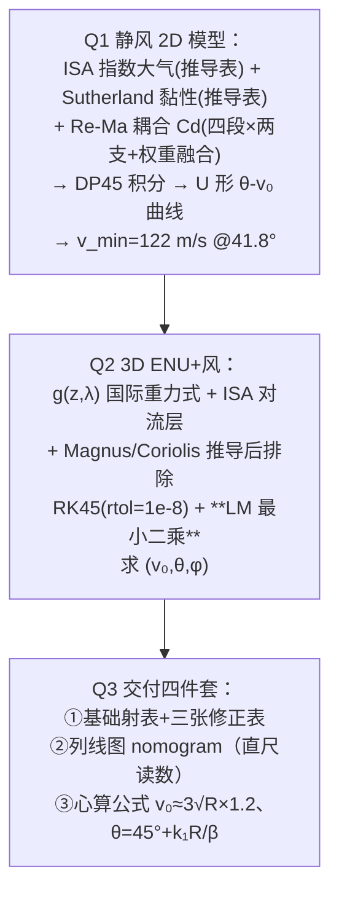

# 2025-GM-B-765（2025 题B · 队伍 765 · 52 页）

## 来自赏析

### 论文速览

论文以"自研 Re–Ma 耦合阻力模型 + 三件套速算工具"为特色：问题一用 2D ODE + Dormand–Prince（RK45）参数扫描得到 100 组 $(\theta, v_0)$ 解对，最小初速 122 m/s @ 41.8°，呈 U 形结构；问题二在 ENU 坐标系中计入随纬度变化的重力（国际重力公式 6.1）、ISA 大气、Sutherland 黏度，用 RK45（rtol=atol=$10^{-8}$）+ Levenberg–Marquardt（三点差分 Jacobian，式 6.39）反解 $(v_0,\theta,\varphi)$，并做风、海拔、距离的单变量扫描；问题三交付"基础射表 + 修正表（表 7.1–7.3）+ 列线图（nomogram，图 27）+ 心算公式（$v_0\approx3\sqrt{R}\times1.2$、$\theta=45°+k_1 R/\beta$）"四层工具，是 9 篇中速算工具形态最全的一篇。

### 获奖密码

1. **Re–Ma 耦合阻力模型是全场最精细的 $C_d$ 处理**：不引用单一文献公式，而是把 Re 分段基准与 Ma 修正因子用权重函数融合，每段都写明物理来源（Oseen 修正、Prandtl–Glauert、波阻 $\propto Ma^2-1$），展现流体力学的功底。
2. **速算工具形态最全**：射表 + 修正表 + 列线图 + 心算公式四位一体，其中列线图（nomogram）是 9 篇中唯一认真制作的可视化计算工具，直击题目"no computers or calculators"。
3. **环境建模穷尽**：纬度相关重力、Sutherland 黏度、ISA 压强/密度分离建模，误差控制（rtol 1e-8、事件检测）写明数值。
4. **推导过程表格化**：大气、黏度、Cd 的推导各配"步骤-逻辑-公式"三列表，可读性与教学性极佳。
5. **AI 使用披露规范**：如实记录查询与完整输出，符合 2025 年起 UPC 对 AI 使用的合规要求，规避学术诚信风险。
6. **结果分析有战术语言**：最低弹道/最高弹道/最小能量三解对应"速射/越障/省药"的战术解释，呼应 19 世纪作战情境。

### 可借鉴清单

1. Re 分段基准 × Ma 修正因子 × 耦合权重的 $C_d$ 融合结构，比单独引用一个经验公式更有"自建模型"含金量，且每段公式都是文献标准结果。
2. 列线图（nomogram）是"无计算器"工具的差异化选择：把射程-仰角-初速做成三尺度对齐图，评委眼前一亮。
3. 心算公式用量纲参数 $\epsilon=R/\beta$（射程/弹道系数）做 Taylor 展开，$\theta=45°+k_1\epsilon$ 的形式优雅且可解释。
4. 修正表按"海拔/高差/顺风"分列仰角与初速双列修正值，比单一角度修正更实用。
5. 推导逻辑用"步骤-逻辑-公式"三线表呈现，可复制到任何模型构建章节。
6. 若使用 AI，按赛事要求在附录披露系统、查询原文与输出全文，把合规风险变成透明加分项。

## 来自精读

### 全文骨架



**为什么这个骨架好**：三层递进不是"三个模型"而是**同一个模型的三次降维**——Q1 的高保真 Cd 在 Q2 简化为 Morrison 式（式 6.10），Q2 的数值结果在 Q3 蒸馏成四件套。每个降维处都声明"为什么可以简"。**52 页的体量靠"推导逻辑表"（Table 5.1–5.3 每个公式配来历四步表）撑住可读性**——这是长文不失控的秘诀。

---

### 建模决策链

| 决策 | 作者的选择 | 被放弃的替代 | 为什么 |
|---|---|---|---|
| Cd 模型 | Re-Ma 分段耦合+权重融合 | 常数/单变量 Cd(M) | 低速黏性+跨声速压缩性两 régime 都要照顾 |
| 大气 | Q1 指数律 / Q2 ISA 幂律 | 单一模型 | ⚠ 两套并存未解释（ρ₀ 还差 1.7%） |
| 黏性 | Sutherland 公式 | 常数 µ | Re 数需要 µ(h) |
| Q2 求解 | LM 最小二乘 | 二分/扫描打靶 | 三参数耦合+方位角；多初值可暴露双解 |
| Magnus/Coriolis | 推导→量级排除 | 直接忽略 | 展示"知道并会算" |
| 交付物 | 射表+修正表+**列线图**+心算 | 单一射表 | 战场时间预算分层 |
| 合规 | AI 报告附 GPT-5/Claude 双输出 | — | 2025 新赛制的极致合规 |

**独立复现审计汇总**：H_p=RT₀/g≈8435≈8500 ✓；Re 出膛 3.3×10⁶ → 超临界段 ✓（式 5.13 生效）；融合 Cd 出膛 0.71（真值 ~0.9，Ma 因子保守）⚠；**Fig 7 读数（0.2/0.27）与公式复算（0.50）不符** ⚠⚠；ρ₀ 双值（1.225/1.205）⚠；v_min=122@41.8° 合理 ✓（真空 108.4@45°+阻力修正）；**心算仰角式只覆盖高角支、与 U 形曲线 41.8° 及低角支矛盾** ⚠⚠；v₀≈3√R×1.2 复算 131 vs 122（7% 内）✓；LM 初值策略与参数边界 ✓ 规范；两套 Cd 模型并存（Q1 Re-Ma / Q2 Morrison 式 6.10）未解释 ⚠。**总评：全库技术野心最大的一篇，"体系分"满分；但多模型并存的口径卫生与图文一致性是它的软肋——52 页的体量下，账本越厚越要勤对账。**

---

### 可复用模板

**结构模板**：
```
4 Assumptions       六条全带 Justification（含一条冷门：准静态）
5 Q1 模型           物理公式+家谱表 → 动态 Cd(分段+耦合) → U 形解
6 Q2 扩展           环境模型(g/ISA/µ) → 三力"推导后排除" → LM 打靶
                    单因素扫描（异常读成物理）
7 Q3 交付四件套     射表→修正表→列线图→心算式（分层=时间预算）
9-10 局限↔改进      五对五一一配对
附录                代码 + AI 使用报告(双系统输出)
```

**句式库**：
- "Employing a constant Cd value—such as the classical 0.47—could lead to range errors of several tens of meters or more, particularly in the transonic regime."（动态建模必要性句）
- "Physically, at Ma = 0.7, the factor is ∼1.4, leading to a slight range reduction."（公式-后果-数字三点一线）
- "Note the vertical error zimp−zt is implicitly enforced by the event detection ..., so it is not explicitly minimized."（优化问题边界的技术声明）
- "These observations collectively demonstrate that the Re-Ma coupling performs effectively."（耦合有效性自证句）
- "This method is particularly suitable for rapid decision-making in battlefield environments, simplifying the original table lookup and correction process into a single line-drawing and reading step."（交付物价值句）

**图表配方**：公式家谱表（四步来历）；动态 Cd 的"心电图"；耦合模型自证双曲线；单因素扫描三组；**列线图**（多参数一线直读）；局限↔改进配对表。

---

*对照阅读：`05_论文赏析/2025/2025-GM-B-765.md`、`07_题目解读/2025_题B_火炮弹道射表.md`（十三队速算流派全景）、队友精读 264（Morrison 公式——本文 Q2 实际采用的 Cd）、796（四层渐进+自旋的全模型对照）。*
