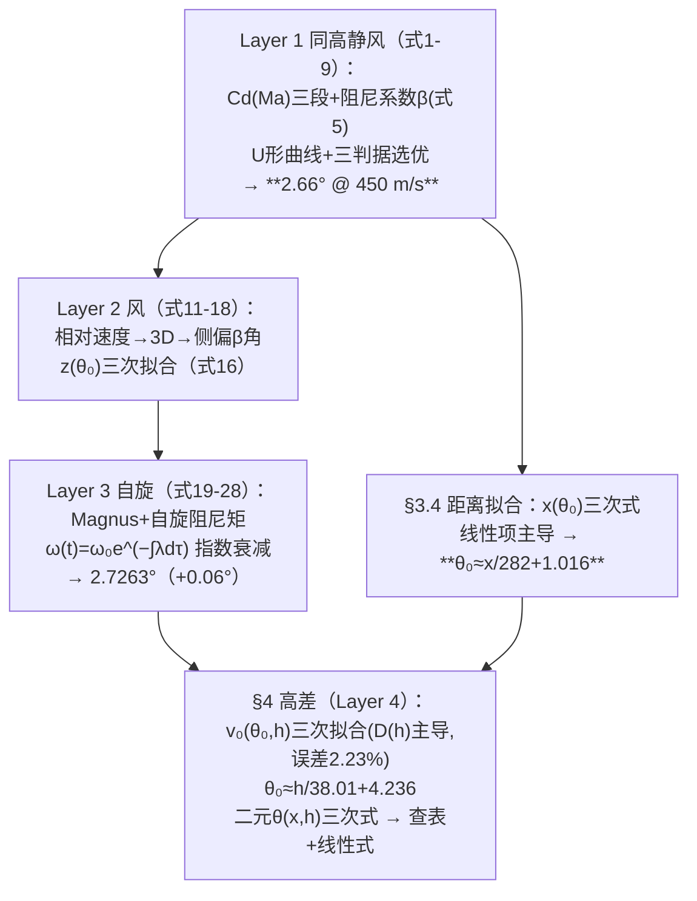

# 2025-GM-B-796（2025 题B · 队伍 796 · 111 页）

## 来自赏析

### 论文速览

论文以大沽口炮台（1841）为历史参照，采用四层渐进建模（基线阻力 → 横风 → 自旋/Magnus → 高差），用 RK45（rtol=$10^{-5}$、atol=$10^{-7}$、步长收敛验证截断误差 ≤0.7 m）数值求解，并引入"飞行时间-落点动能-弹道高"三指标选择最优解：满装药 450 m/s 下最优仰角 2.66°（类手枪直射）。全文最终把数值结果蒸馏成一套手算公式：$\theta_0\approx x/282+1.016$（式 30）、含高差 $v_0(\theta_0,h)=0.0010\theta_0^3-0.1026\theta_0^2+4.25\theta_0+(0.0042h^2-0.315h+428.7)$（式 33，平均误差 2.23%）、$\theta_0\approx h/38.01+4.236$（式 35）、横风侧偏修正 $\beta=\frac{u}{5}\cdot\frac{0.0006\theta_0^3-0.072\theta_0^2+2.85\theta_0+2.15}{x}$（式 18）以及线性综合式（式 37）。

### 获奖密码

1. **最优解的"多准则决策"**：不只给命中解，而是用飞行时间（战术时效）、落点动能（杀伤力）、弹道高（可预测性）三指标在解曲线上选点，结论（450 m/s + 2.66°）自带战术解释，回应"optimal"的题眼。
2. **可忽略性判定写成了定量规则**：海拔 ±500 m→2% 可忽略、>500 m→5% 必须考虑；侧风 2.1 m 偏移结合历史火炮精度判可忽略、大仰角必须修正——每个简化都有阈值和理由。
3. **拟合分层降维的手算哲学**：三次式 → 识别主导项 → 线性式的压缩链条（$\theta_0=x/282+1.016$ 是全场最简的射角公式），并诚实报告每级拟合的误差。
4. **自旋动力学全链路建模**：转动惯量、气动阻矩、转速指数衰减、Magnus 修正一应俱全，在"忽略 Magnus"为主流的 9 篇中独树一帜。
5. **历史锚定**：大沽口炮台、19 世纪瞄准具与风测手段（旗帜/烟/植被）、地图高程来源逐一考证，背景综述（Lambert W 解析近似、Chudinov 系列、AJP 最优角文献）显示文献功底。

### 可借鉴清单

1. "曲线族 + 目标横线"的读图设计：把所有 $R(\theta;v_0)$ 曲线画在一图并加目标射程线，多解结构一眼可读。
2. 三指标（时间/动能/弹道高）选优框架可移植到任何"最优发射参数"类问题。
3. 简化公式的标准流程：数值解 → 多项式拟合 → 检验主导项 → 线性压缩 → 报告每级误差（2.23%、1.47° 等数字必须保留）。
4. 侧偏修正写成 $\beta=\frac{u}{u_{ref}}\cdot\frac{z(\theta_0)}{x}$ 的"参考风速标定 + 线性缩放"形式，一条曲线覆盖全部风速。
5. 转速衰减 $\omega=\omega_0e^{-\lambda t}$ + Magnus 修正是给弹丸加自旋的最低成本方案（一个标量 ODE）。
6. 排版警戒清单：Word 转 PDF 的公式乱码、URL 里的 AI 痕迹、附录代码与正文求解器名称不一致——这些细节在 111 页长文中会累积成可信度损耗。

## 来自精读

### 全文骨架



**为什么这个骨架好**：四层不是四个模型，是**一条"效应贡量化"流水线**——每层只加一个效应并立刻量化（风：低角 <3%、高角显著；自旋：+0.06°；高差：θ₀ 敏感度 1°/38 m）。评委可以看到每个简化决策的数字依据。111 页的体量下，**摘要把六条最终公式全部印出**——这是对"评委只读摘要"的终极应对。

---

### 建模决策链

| 决策 | 作者的选择 | 被放弃的替代 | 为什么 |
|---|---|---|---|
| 建模结构 | 四层渐进（效应逐个量化） | 一步到位全耦合 | 每层的贡献可单独审计（风 <3%、自旋 +0.06°） |
| Cd | 三段 Ma 式（同 2011-B-379） | Re-Ma 耦合（765）/常数（127） | 传承经典拟合；出膛 Cd=1.13（全库最高） |
| 自旋 | 二阶段解耦（先 ω(t) 后 Magnus） | 6-DOF 全耦合 | 指数衰减解析解+效应小 |
| 公式蒸馏 | 立方拟合→主导项→线性式（三级） | 直接线性回归 | 每级报误差（4%/2.23%/1.47°） |
| 参数处理 | D(h) 精修、A/B/C 平均 | 全系数逐 h 拟合 | 主次分级（⚠ 高角支 A 极差 6×） |
| 交付 | 六公式+查表+线性式 | 列线图（765）/野战卡（428） | 公式链+表格的组合 |

**独立复现审计汇总**：β=ρC_dπD²/8m ✓（与 ½ρC_dAv² 一致）；三段 Cd(Ma) 与 2011-B-379 逐字同源 ✓；出膛 Cd=1.127（三段式在 Ma=1.33 的值，全库最高）⚠ 与最小射角 2.66° 并存的口径考古；**式 35 @h=0 给 4.24° vs 案例一 2.66°（命中边界 vs 判据最优两口径混用）** ⚠⚠；A 系数极差 6× 被平均 ⚠（低角支无害、高角支翻倍）；k₀=16.7 排版截断（从算例反推复原）⚠；线性式 k₁ 负号（高角支物理）与 §3.4 正号（低角支）并存未声明 ⚠；自旋指数衰减 λ∝V_rel 推导 ✓；能量审计（对照 471 的自曝）本文未做 ⚠。**总评：公式蒸馏链与四层量化是全库最完整的"降维方法论"标本；多口径混用与排版事故则提醒——111 页的体量需要更严的"口径登记表"。**

---

### 可复用模板

**结构模板**：
```
1.2 Background      四支柱综述（模型/自旋/历史测量能力/数值方法）
1.3 Analysis        四层路线图（每层一个量化使命）
3 Layer1-3          每层：方程→扫描→"感知流程"直观算例→效应量化
3.4-4 公式蒸馏链    拟合→主导项→降维→再验证（每级报误差）
                    参数分级（主导精修/次要平均）
5-6 结论+强弱       六公式编号列全；弱点两条
```

**句式库**：
- "a stepwise modeling strategy is advisable: start from a baseline model and then introduce realistic effects incrementally, quantifying each contribution."（四层方法总纲句）
- "This lays the foundation for subsequent models that incorporate altitude differences."（层间衔接句）
- "It is observed that in Equation 28, the constant term D dominates. We now fit D against h ..."（**参数主导项发现句**——降维的核心动作）
- "However, this formula involves numerous squared terms and is slow to calculate without a calculator. To address this, we propose two methods."（降维动机句）
- "For large launch angles, this absolute error is negligible. Therefore, the simplified model also maintains sufficient accuracy for practical applications."（降维验收句）

**图表配方**：感知流程三算例开路；每层"扫描底图+拟合曲线"；**系数表+R² 全印**；高级 vs 简化算例对比；摘要印全部最终公式。

---

*对照阅读：`05_论文赏析/2025/2025-GM-B-796.md`、`07_题目解读/2025_题B_火炮弹道射表.md`、队友精读 102（⚠ 弹簧投影对比篇）、471（立方弹簧正确推导）、765（Re-Ma 耦合 vs 本文三段式）、127（拟合式-数据断裂的另一种死法）。*
